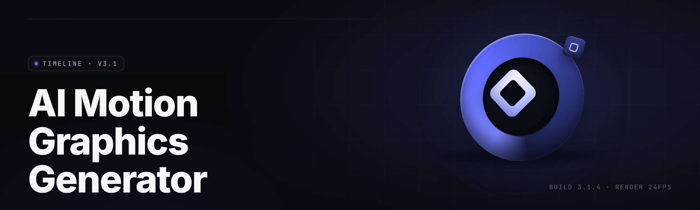

  
  
  

  

  
  

---

**Type a prompt. Get broadcast-grade motion graphics.** The 2026 build ships 34 modules that turn plain text into keyframed, layer-tracked, render-ready animation — no timeline wrangling, no plugin stack, no render farm.

---

## 🎬 Overview

The AI Motion Graphics Generator is a desktop `.exe` for Windows that compiles natural-language prompts into fully keyframed motion graphics compositions. You describe the shot — "logo reveal, liquid chrome, 4-second loop, 60fps" — and the engine parses intent, assembles layers, generates easing curves, tracks elements, and exports to MP4, ProRes, or a layered project file. It runs local-first on your GPU; no cloud round-trip, no watermark, no seat license.

| Category | Details |
|---|---|
| Distribution | Single portable `.exe`, extract-and-run |
| Engine | Local diffusion + procedural keyframe compiler |
| Input | Text prompts, reference images, SVG/AI vector import |
| Output | MP4, MOV (ProRes 422), PNG sequence, layered project |
| Render mode | GPU (CUDA / DirectML) with CPU fallback |
| Prompt language | Plain English + shorthand tokens (`loop`, `ease-out`, `4k`) |
| Presets | 340 built-in motion templates |
| Update channel | In-app updater, stable + beta tracks |

This build leans hard on the 2026 keyframe compiler — the part that reads "snappy but not jarring" and actually picks a bezier instead of a linear ramp. It's the difference between a template and a shot that feels authored.

### ⬇️ Get the build

  

---

## 📖 What is the AI Motion Graphics Generator

| Term | Explanation |
|---|---|
| Prompt Compiler | Parses plain-English shot descriptions into a structured scene graph |
| Keyframe Solver | Generates easing, timing, and interpolation from intent verbs |
| Layer Assembler | Auto-builds text, shape, image, and 3D layers from one prompt |
| Motion Tracker | Tracks points across footage and parents generated elements to them |
| Style Engine | Applies consistent look (chrome, glass, neon, print) across a comp |
| Render Queue | Batches exports with per-job codec, bitrate, and resolution |
| Preset Graph | 340 reusable motion templates you can branch and remix |

- **Zero timeline tax** — you never hand-place a keyframe unless you want to.
- **Local-first** — prompts and renders never leave the machine.
- **Deterministic runs** — same seed + same prompt = same comp, every time.
- **Interoperable** — export a layered project and keep editing downstream.
- **GPU-aware** — auto-detects VRAM and scales tile size to fit.

---

## 🧩 Key Features

| Feature | Description | Benefit |
|---|---|---|
| Prompt-to-Compile | Turns a sentence into a keyframed composition | Skip manual layer setup |
| Easing Solver | Picks bezier curves from intent words | Motion reads as intentional |
| Auto-Tracking | Parents generated elements to tracked footage | Graphics stick to moving subjects |
| Style Lock | Holds one look across every scene in a project | Brand consistency, no drift |
| Vector Import | Reads SVG/AI and animates paths | Reuse existing brand assets |
| 3D Extrude | Pulls flat layers into lit 3D geometry | Depth without a 3D app |
| Loop Seam | Matches first/last frame for seamless loops | Perfect for web + social |
| Render Queue | Batch jobs with per-job export settings | Overnight export runs |
| Seed Control | Lock a seed to reproduce a comp exactly | Versionable motion |
| Preset Branching | Fork any of 340 templates and remix | Fast starting points |
| Proxy Preview | Half-res realtime preview while you tune | No waiting to see the shot |
| Project Export | Writes a layered file for downstream edit | No lock-in |

---

## 🗂️ Module Status

34 modules ship in v2.6.1. This table lists the ones users touch most.

| Module | Status | Description |
|---|---|---|
| Prompt Compiler | ✅ Working | Sentence → scene graph |
| Keyframe Solver | ✅ Working | Intent → easing curves |
| Layer Assembler | ✅ Working | Auto layer + group build |
| Style Engine | ✅ Working | Cross-comp look lock |
| Motion Tracker | ✅ Working | Point + planar tracking |
| Vector Importer | ✅ Working | SVG / AI path animation |
| 3D Extrude | ✅ Working | Flat → lit geometry |
| Loop Seam | ✅ Working | Seamless loop matching |
| Render Queue | ✅ Working | Batch export jobs |
| Seed Locker | ✅ Working | Reproducible comps |
| Proxy Preview | ✅ Working | Realtime half-res |
| Codec Bridge | ✅ Working | MP4 / ProRes / PNG |
| Preset Graph | ✅ Working | 340 template branches |
| Audio Sync | ✅ Working | Beat-map keyframe timing |
| Color Manager | ✅ Working | LUT + ACES pipeline |
| Text Animator | ✅ Working | Per-glyph motion |
| Particle Field | ✅ Working | GPU particle sim |
| Mask Solver | ✅ Working | Auto-rotoscope masks |
| Depth Pass | ✅ Working | Monocular depth for parallax |
| Expression Engine | ✅ Working | Lightweight scripting layer |
| Cache Manager | ✅ Working | Disk + VRAM cache control |
| Undo Tree | ✅ Working | Branching undo history |
| Snapshot Tool | ✅ Working | Named comp states |
| Collab Export | ✅ Working | Shareable project bundles |
| Theme Kit | ✅ Working | UI + comp theme packs |
| Font Resolver | ✅ Working | Missing-font auto-swap |
| Asset Relinker | ✅ Working | Fix broken media paths |
| Proxy Switcher | ✅ Working | Per-layer proxy toggles |
| GPU Scheduler | ✅ Working | Multi-GPU job routing |
| Watch Folder | ✅ Working | Auto-render on file drop |
| CLI Headless | ✅ Working | Scripted batch runs |
| Update Client | ✅ Working | In-app stable/beta |
| Crash Guard | ✅ Working | Autosave + recovery |
| Telemetry Opt-Out | ✅ Working | Off by default |

---

## 🎯 The Problem

- Prompt-to-video tools spit out unkeyframed mush you can't re-time or re-brand.
- Timeline editors give you control but cost hours to place every move by hand.
- Cloud render services watermark drafts and bill per minute of output.
- Style drifts between scenes because nothing enforces a look across a project.
- Exports come back as flat video with no layered project to keep editing.
- Tracking generated graphics onto real footage is a manual, brittle chore.
- Reproducing a render six months later is guesswork with no seed control.

---

## 🛠️ The Solution

| Problem | Solution |
|---|---|
| Unkeyframed mush | Keyframe Solver emits real curves you can hand-edit |
| Hours of manual placement | Prompt Compiler builds the comp from a sentence |
| Cloud watermarks + per-minute billing | Local GPU render, no watermark, no meter |
| Style drift between scenes | Style Engine locks one look across the project |
| Flat video-only exports | Project Export writes a layered file |
| Brittle manual tracking | Motion Tracker parents elements automatically |
| Non-reproducible renders | Seed Locker reproduces any comp exactly |

---

## 📚 Table of Contents

- [Overview](#-overview)
- [What is the AI Motion Graphics Generator](#-what-is-the-ai-motion-graphics-generator)
- [Key Features](#-key-features)
- [Module Status](#-module-status)
- [The Problem](#-the-problem)
- [The Solution](#-the-solution)
- [Feature Categories](#-feature-categories)
- [System Requirements](#-system-requirements)
- [Installation](#-installation)
- [Tips for Best Results](#-tips-for-best-results)
- [Comparison](#-comparison)
- [Known Issues](#-known-issues)
- [FAQ](#-faq)

---

## 🎨 Feature Categories

### ✍️ Prompt & Intent

The prompt layer is where the 2026 build earns its keep. You write a shot like you'd brief a human animator — verbs, timing feel, mood — and the compiler resolves ambiguity into a concrete scene graph. It distinguishes "slow drift" from "deliberate slide," and it treats `loop`, `seamless`, and `4-second` as first-class tokens rather than text to ignore.

- **Shot Parser** — sentence → structured scene graph.
- **Intent Verbs** — maps "snap," "settle," "breathe" to easing families.
- **Token Shorthand** — `loop`, `ease-out`, `4k`, `60fps` recognized inline.
- **Ambiguity Resolver** — asks once when two shots are equally likely.
- **Prompt Memory** — reuses your style tokens across a session.

### 🌀 Motion & Timing

Motion is the part most generators fake. Here the Keyframe Solver picks interpolation from intent, then exposes every curve for hand-tweaking. Audio Sync maps beats to keyframe timing so cuts land on the downbeat without manual nudging.

- **Easing Solver** — bezier selection from intent words.
- **Audio Sync** — beat-map drives keyframe timing.
- **Loop Seam** — matches first/last frame for perfect loops.
- **Speed Ramp** — retime any layer without recompiling the comp.
- **Snap Grid** — quantize moves to frame boundaries.

### 🧱 Layers & Compositing

Layers assemble themselves but stay fully editable. Group, parent, and mask behavior is standard — nothing is baked. The Mask Solver auto-rotoscopes subjects so generated text can sit behind a person without manual mattes.

- **Layer Assembler** — text, shape, image, 3D from one prompt.
- **Auto Grouping** — sensible hierarchies on compile.
- **Mask Solver** — auto-rotoscope subject mattes.
- **Blend Stack** — full compositing blend modes.
- **Parent Chains** — standard parenting, no hidden rigs.

### 🎭 Style & Look

Style Lock holds one look across every scene. Pick chrome, glass, neon, or print, and the engine keeps materials, lighting, and grain consistent from shot to shot. Color Manager runs LUTs and an ACES pipeline for delivery-safe color.

- **Style Engine** — cross-comp look lock.
- **Material Kit** — chrome, glass, neon, print presets.
- **Color Manager** — LUT + ACES pipeline.
- **Grain Match** — consistent film grain across scenes.
- **Theme Kit** — UI and comp theme packs.

### 🖥️ Render & Export

The render path is local and batched. Render Queue handles per-job codec, bitrate, and resolution. Watch Folder auto-renders when a file drops. CLI Headless runs scripted batch jobs for pipeline work.

- **Render Queue** — batch jobs with per-job settings.
- **Codec Bridge** — MP4, ProRes 422, PNG sequence.
- **Watch Folder** — auto-render on file drop.
- **CLI Headless** — scripted, no-GUI batch runs.
- **Proxy Preview** — realtime half-res while tuning.

### ⚙️ Pipeline & Project

Projects stay portable. Asset Relinker fixes broken media paths, Collab Export bundles a shareable project, and the Undo Tree gives branching history so you can explore without losing your spot.

- **Project Export** — layered file for downstream edit.
- **Asset Relinker** — repair broken media paths.
- **Undo Tree** — branching undo history.
- **Snapshot Tool** — named comp states.
- **Collab Export** — portable project bundles.

---

## 🖥️ System Requirements

| Component | Minimum | Recommended |
|---|---|---|
| OS | Windows 10 21H2 (64-bit) | Windows 11 23H2+ |
| CPU | 6-core / 12-thread | 12-core / 24-thread |
| RAM | 16 GB | 32–64 GB |
| GPU | 6 GB VRAM, DirectML | 12–24 GB VRAM, CUDA |
| Storage | 8 GB free (SSD) | 40 GB NVMe scratch |
| Display | 1920×1080 | 2560×1440 or higher |
| Runtime | DirectX 12 | DirectX 12 + CUDA 12 |

> GPU VRAM drives tile size. Below 6 GB, large comps auto-switch to CPU fallback and slow noticeably — set a Proxy Preview before you blame the engine.

---

## 🧷 Installation

1. **Download the build.** Grab the portable `.exe` from the project page using the download macro below. No installer wizard, no package manager, no `git clone`.
2. **Extract to a writable folder.** Right-click the archive → Extract All → pick a folder you own (avoid `Program Files`, which blocks the cache). Keep the extracted folder intact — the `.exe` reads sibling assets.
3. **Run the `.exe`.** Double-click it. First launch warms the GPU shader cache (20–60 seconds) and writes a config in `%APPDATA%\AIMG`. Subsequent launches open in a few seconds. If SmartScreen flags an unsigned portable app, choose **More info → Run anyway**.

  

---

## 💡 Tips for Best Results

- Write prompts as **shots**, not descriptions: "chrome logo reveal, snaps in, holds 2s" beats "a nice logo animation."
- Lock a **seed** the moment a comp looks right — that's your versionable motion.
- Use **Proxy Preview** while tuning timing, then switch to full-res only for final render.
- Match your **Style Engine** preset to the delivery medium before the first render.
- Turn on **Watch Folder** for overnight batch jobs — drop files, wake up to renders.
- Keep the **scratch drive** on NVMe; cache-heavy comps crawl on spinning disks.
- Export a **layered project** if you'll color-grade or re-cut downstream.
- Run **Audio Sync** before hand-tuning a beat — it gets you 90% there instantly.

---

## 🆚 Comparison

| Aspect | Cloud Prompt-Video Tools | Timeline Suites | This Tool |
|---|---|---|---|
| Prompt → keyframed comp | Flat video only | Manual | Full keyframes |
| Watermark | Often | No | No |
| Per-minute billing | Yes | No | No |
| Style consistency | Weak | Manual | Style Lock |
| Layered project export | No | Yes | Yes |
| Local GPU render | No | Yes | Yes |
| Reproducible seed | Rare | Manual | Built-in |
| Editable easing curves | No | Yes | Yes |

---

## 🐞 Known Issues

| Issue | Solution |
|---|---|
| First launch slow (shader warmup) | Expected, 20–60s once; leave it |
| CPU fallback on low-VRAM GPUs | Lower tile size or enable Proxy Preview |
| Missing fonts on imported projects | Font Resolver auto-swaps; set a fallback |
| Broken media paths after moving files | Run Asset Relinker |
| Watch Folder misses network drives | Use a local folder, sync separately |
| Export stalls at 99% | Check scratch-drive free space |

---

## ❓ FAQ

Does the app need an internet connection to render?

No. Everything runs locally on your GPU. The only network use is the optional in-app update client.

Will it run on a laptop GPU?

Yes, if you have 6 GB VRAM or more. Below that it falls back to CPU and slows down — use Proxy Preview while tuning.

Can I edit the keyframes the AI generates?

Always. The Keyframe Solver produces real, standard curves. Nothing is baked. Hand-tweak any of them.

Does it add a watermark to exports?

No. Local renders are clean at any resolution.

What formats can I export?

MP4, MOV (ProRes 422), PNG sequence, plus a layered project file for downstream editing.

Is there a CLI for batch rendering?

Yes. CLI Headless runs scripted, no-GUI jobs — useful for pipeline and overnight runs.

How do I make a perfect loop?

Use the `loop` token in your prompt and enable Loop Seam. The engine matches first and last frames.

Can I reuse a look across multiple scenes?

Yes. Style Lock holds materials, lighting, and grain consistent across every scene in a project.

Where does the app store its cache?

In `%APPDATA%\AIMG` by default. Point the scratch drive at an NVMe SSD for best performance.

Does the update client force upgrades?

No. You choose stable, beta, or hold. Nothing updates silently.

---

The 2026 build is the first release where the keyframe solver and the style engine actually agree on what a shot should feel like — motion that reads as authored, not generated. It ships portable, runs local, and hands you back a layered project you own. Type a shot, hit render, and stop fighting the timeline.
